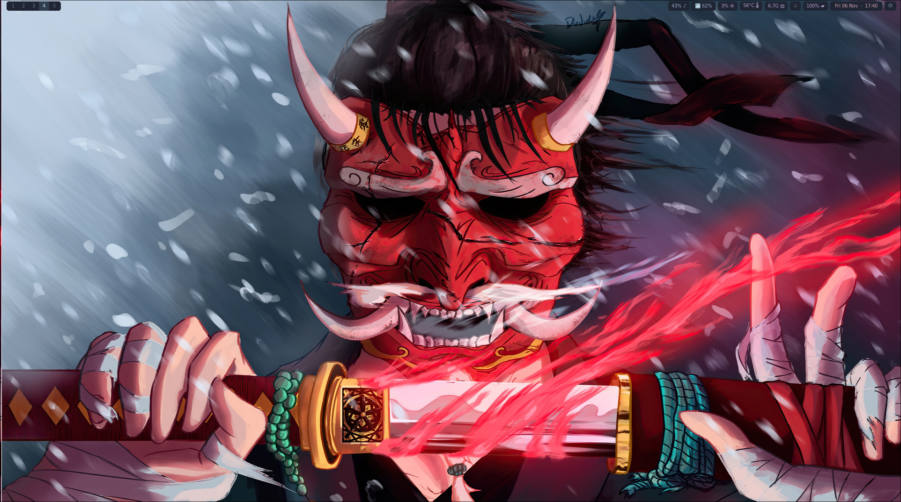

# ONI — Fedora / Arch



*Wallpaper que inspira a paleta do tema; não é uma captura da sessão Hyprland.*

Requer Hyprland 0.55 ou superior, com configuração exclusivamente Lua.

Tema baseado no samurai do wallpaper: vermelho, carvão e azul gelo. Waybar fina e transparente, com indicadores em pequenos blocos escuros, ícones Unicode e tons de azul e lilás; os valores são métricas reais. O relógio alterna entre hora e data ao clicar. Os ícones usam DejaVu Sans e Noto Sans Symbols 2 quando disponível, sem depender de Nerd Fonts.

## Instalar

```bash
cd ~/dotfiles
./install-deps.sh
./install.sh --dry-run
./install.sh
```

O instalador de dependências solicita sudo e a confirmação do gerenciador. Instala o próprio Hyprland. Suporta Fedora tradicional e EndeavourOS, Arch, Manjaro, Garuda e outras distribuições que declarem ID_LIKE=arch com os pacotes disponíveis nos repositórios oficiais. No Fedora habilita o COPR comunitário nett00n/hyprland mediante confirmação do DNF; no Arch/EndeavourOS usa pacman e não usa AUR nem troca o gerenciador de login. Fedora Atomic não é suportado automaticamente.

O instalador dos links roda SEM sudo. Vincula somente hypr, waybar, rofi, wofi, mako, wallpapers e qt6ct dentro de `${XDG_CONFIG_HOME:-$HOME/.config}`. Não substitui a .config inteira. Configurações existentes dessas pastas são movidas para `.config/dot-backup.XXXXXXXX`; configurações do KDE permanecem no lugar. Pode executar novamente sem duplicar links. Não mova a pasta DOT depois da instalação.

Saia da sessão e escolha Hyprland no login. O wallpaper é iniciado com swaybg em todos os monitores.

## Organização

- `hypr/hyprland.lua`: entrada para Hyprland 0.55+; módulos em `hypr/lua`.
- `hypr/local.lua`: arquivo opcional para ajustes pessoais carregado por último; crie para configurar monitores e dispositivos específicos.
- `hypr/scripts`: cheatsheet no terminal, controle de volume e captura de região para clipboard.
- `waybar/style.css`: cores e aparência do HUD; `waybar/config`: módulos.
- `rofi/oni.rasi`: launcher; `mako/config`: notificações; `wofi`: alternativa visual.

Teclado brasileiro; HDMI-A-1 principal a 1920×1080/144 Hz e eDP-1 secundário a 1920×1080/144 Hz, conforme o perfil original. Notebook à esquerda, HDMI à direita; workspace 1 e cursor inicial no HDMI. Outros monitores usam detecção automática. SUPER+Q terminal, SUPER+R launcher, SUPER+E Dolphin, SUPER+C fecha janela, SUPER+I captura região, SUPER+Escape bloqueia, SUPER+1…0 muda workspace e SUPER+Shift+1…0 move janela. SUPER+Shift+Space alterna fullscreen.

## Restaurar

Saia do Hyprland. Para cada pasta desejada, confira com `readlink ~/.config/hypr` se é o link para esta DOT; remova somente esse link com `unlink ~/.config/hypr` e mova a pasta correspondente do backup de volta. Repita para as outras pastas. Nunca remova a .config inteira.

## Limites e validação

Scripts verificados com bash -n e instalação testada em diretório temporário com conflito, backup e segunda execução. Não foram instalados pacotes nem iniciada uma sessão gráfica durante a preparação. Aparência e compatibilidade completa com a versão instalada precisam ser verificadas após login; use `hyprctl configerrors`. Os módulos Lua existentes foram preservados e adaptados à API 0.55; não é possível prometer compatibilidade com toda versão futura.

## Aparência dos aplicativos

GTK usa Adwaita escuro e Qt6 usa qt6ct/Fusion com paleta darker. A variável Qt só é aplicada na sessão Hyprland; não alteramos kdeglobals. A preferência GNOME color-scheme=prefer-dark é persistente para o usuário e pode afetar apps GTK em outras sessões. Firefox deve estar com tema Sistema/Automático; temas e preferências explícitos de um aplicativo têm prioridade. Não alteramos perfis do Firefox, não instalamos extensões e não forçamos sites sem suporte a modo escuro. Apps Qt5/Flatpak ou com tema próprio podem exigir ajuste no aplicativo. O visual do Hyprland e da Waybar foi mantido.

A revisão inclui qt6ct na lista de pastas vinculadas, com backup da configuração anterior. O tema darker é fornecido pelo pacote qt6ct.

O Dolphin pode usar um esquema próprio, independente da paleta do qt6ct. Se abrir claro, selecione **Configurações → Esquema de cores → Breeze Dark** no Dolphin. A escolha é salva em `dolphinrc` e também pode afetar o Dolphin em outras sessões; o instalador não sobrescreve esse arquivo.

## Módulos do Hyprland

| Arquivo em `hypr/lua` | Responsabilidade |
| --- | --- |
| `monitors.lua` | Resolução, frequência, posição e monitor inicial do cursor |
| `workspaces.lua` | Associação dos workspaces aos monitores |
| `appearance.lua` | Bordas, cores, espaçamentos, transparência e blur |
| `animations.lua` | Curvas e animações |
| `layouts.lua` | Comportamento dos layouts |
| `input.lua` | Teclado, mouse, touchpad e gestos |
| `misc.lua` | Comportamento geral e cursor |
| `window-rules.lua` | Regras específicas de janelas |
| `keybinds.lua` | Atalhos |
| `programs.lua` | Aplicativos padrão |
| `variables.lua` | Variáveis de ambiente e tema dos apps |
| `autostart.lua` | Inicialização da sessão |

`hypr/local.lua` continua opcional e é carregado por último para ajustes pessoais. A configuração original dos monitores foi restaurada; confira os modos no hardware real com `hyprctl monitors all`. O ajuste de posição `1921x0` preserva o workaround original; pode ser mudado para `1920x0` caso já não seja necessário.

## Verificação na sessão gráfica

Depois de instalar e entrar no Hyprland, execute `hyprctl configerrors` e `hyprctl monitors all`. Confira fullscreen (Super+Shift+Space), terminal flutuante (Super+Shift+Q), ajuda (Super+H), scroll dos workspaces e captura (Super+I). Este repositório foi revisado estaticamente; não houve execução de Hyprland, Waybar, Rofi ou Hyprlock no ambiente de revisão. A versão dos pacotes da sua distribuição e os modos suportados pelos monitores precisam ser conferidos no sistema real.

## Testes automatizados

Execute como usuário normal, sem sudo, na raiz do repositório:

```bash
python3 tests/run.py
```

O resumo aparece em português. Se já estiver dentro de `tests`, execute `python3 run.py`. Para a lista técnica completa, use `python3 -B -m unittest discover -s tests -v` na raiz do repositório.

Requer Python 3, Bash e utilitários básicos de Linux. Para conferir a sintaxe Lua, instale também `lua` (com `luac`); sem ele, esse teste aparece como `skipped`, não como aprovado.

A suíte verifica sintaxe Bash/Lua, JSON da Waybar, referências dos módulos, links simbólicos, backups, preservação do KDE, reinstalação, mudança do nome da pasta, simulação sem escrita e entradas inválidas. Também testa captura cancelada, falha e sucesso usando ferramentas simuladas.

Os testes de instalação usam diretórios temporários e uma cópia do instalador. Não instalam pacotes, não acessam a `.config` real e não capturam sua tela. Não validam a API real do Hyprland, aparência dos temas, disponibilidade dos pacotes nem compatibilidade dos monitores; essas verificações continuam dependendo do sistema e da sessão gráfica reais.

Quando disponíveis, a suíte também verifica a leitura do tema pelo Rofi e consulta `hyprctl configerrors` na sessão Hyprland ativa. A consulta verifica a configuração carregada na sessão, que pode ser diferente da configuração deste repositório; sem acesso à sessão, o teste é ignorado.

A Waybar mostra a RAM usada em GiB. O botão de energia alterna os perfis disponíveis do `power-profiles-daemon`; o serviço precisa estar ativo e os perfis disponíveis dependem do equipamento.

### Inicialização da sessão

Waybar, mako e swaybg são iniciados diretamente em `hypr/lua/autostart.lua`, no evento `hyprland.start`. A mesma configuração aplica as preferências de tema e inicia o agente de autenticação. Não há script intermediário nem supervisor de processos.

Saia e entre novamente na sessão para aplicar a mudança e encerrar os supervisores da versão anterior. O evento de início não é uma ação de retorno da suspensão; a causa da perda da conexão Wayland após suspender ainda precisa ser investigada.

### Atalhos (Super+H)

O Super+H abre a lista de atalhos no Kitty, usando `hypr/scripts/cheat_sheet.lua`.
Pressione Enter para fechar.
